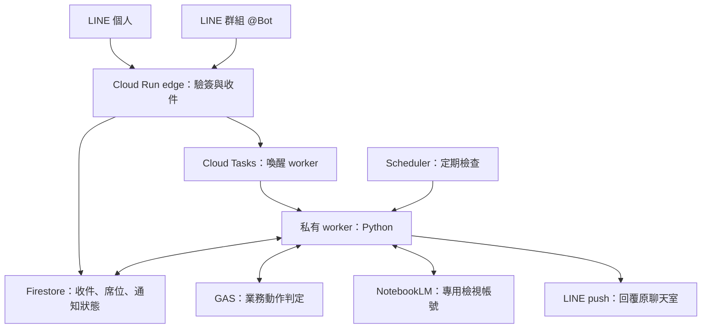

# 憶起照顧 LINE × NotebookLM 技術 MVP

讓使用者透過 LINE 個人或群組聊天室，查詢共享的照護知識語料。

**狀態：技術 MVP 功能凍結；文件整理版 v0.1，快照日期 2026-11-18（臺灣時間）。本 Repo 先以私有方式供審閱，尚未公開。**

本專案用單一專用 NotebookLM 檢視帳號、單席位先進先出排隊，在獨立測試環境串接 LINE、GAS、Cloud Run 與 Python。它是期末報告的實作延伸案例；目前的技術驗證不代表正式照護服務、醫療內容正確性或長期服務保證。

## 與 7A2 的關係

本 Repo 參考 [7A2 文件專案](https://github.com/TaylorShiehUSI/yichi-care-diamond2-docs)的編排方法。LINE MVP 有自己的架構、版本及驗證證據，沒有部署進 7A2，也不沿用 7A2 的驗收結論。**不得修改任何 7A2 成果**，包括程式、部署、既有文件、來源與分享設定。

## 使用者流程

使用者要求加入 → 等待／輪到通知 → 傳送問題並追問 → 回答送回原聊天室 → 主動結束或到期 → 核對清除後交接下一人。群組每次以真正的 @Bot 提及發送指令或問題；答案對原群組成員公開。

**多人可提出使用需求，一次服務一人；同一持有者可多輪。** 20 帳號池是曾討論的替代方案，尚未建立或驗證；排隊人數不等於同時服務人數。

## 架構概覽

概念上的 LINE ↔ GAS ↔ Cloud Run，實際包含 edge 驗 LINE 原始簽章及 Firestore 保存狀態。GAS 判斷業務動作；單席位、FIFO 和通知狀態由 worker／Firestore 管理。NotebookLM 查詢依賴非官方 `notebooklm-py`，不等同官方 NotebookLM API。

## 成果與證據界線

| 證據層級 | 已有結果 | 不可推論 |
|---|---|---|
| Koopman 測試筆記本 | 專用檢視者程式查詢、雲端執行；真 LINE 個人多輪與引用核對；標記對照的清除隔離測試 | 不可直接當成照護語料引用／隔離也通過 |
| 本機模擬 | 排隊原型及路由測試；群組／跨入口版本合計 32 項本機路由與排隊測試 | 不是 32 項雲端測試，也不是真人負載 |
| 雲端模擬 | 真 Firestore 的 21 項指定測試、FIFO、併發去重、排程交接 | 當時 LLM／通知為模擬；不涵蓋後來的 Cloud Tasks 完整故障重試驗證 |
| 真人跨入口 | 同一人在個人／群組交錯使用，觀察等待、邀請、原聊天室回覆及清除交接 | 不等於多位不同真人的 FIFO 測試 |
| 真實照護語料 | 核對指定筆記本、檢視權限、49 筆來源；個人／群組各一題完成；結束後歷史為 0、席位 IDLE | 兩則答案引用均未核對成功；照護多輪及換人標記隔離未另測 |

## 目前主要限制

- 照護答案雖有數字引用標記，`citation_verified=false`，已核對來源摘錄為 0；仍待診斷與重測。
- 10 分鐘使用上限已做模擬邊界測試，完整真實時間 10 分鐘測試尚待補。
- 閒置規則為最後一次接受問題後 2 分鐘；每分鐘排程加上忙碌延遲，不保證精確在第 120 秒回收。
- 曾觀察排程 429 與唯讀上游 503；後續檢查及收尾完成，不代表已驗證高可用。
- 長期登入、不同真人 FIFO、容量／費用、完整故障接管與營運復原仍待驗證。

## 文件閱讀順序

1. [需求與範圍](mvp/requirements.md) → [現行規格](mvp/spec.md) → [工作分解](mvp/wbs.md)
2. [專案管理與保護邊界](mvp/project-management.md)
3. [從想法到方案的決策](mvp/decisions.md)
4. [系統架構](architecture/system.md) → [資訊流與時序](architecture/information-flow.md) → [席位狀態機](architecture/state-machine.md)
5. [驗收矩陣與去識別證據摘要](acceptance/acceptance.md)
6. [個人／群組操作說明](mvp/user-guide.md)

## 期末報告可呈現的亮點

從一個未確定能否程式查詢的構想，逐步驗證帳號、雲端、上下文清除、排隊與 LINE 入口，再切換真實照護語料。面對單帳號共用對話的限制，透過單席位、使用期限、FIFO 與交接前清除，建立可展示的資訊流與使用秩序。報告同時揭露引用及多人實測缺口，讓成果可檢查、限制可追溯。

## 文件範圍與公開原則

本 Repo 僅收錄文件、圖及去識別驗證摘要；不收錄運行程式、原始測試 ZIP、憑證、Cookie、原始聊天、LINE 識別碼或來源全文。公開文件採元件角色與證據代號，不寫入實際雲端／帳號部署識別資料。Repo 須經使用者審閱後，另行決定是否公開；文件提交不會改動運行系統。
