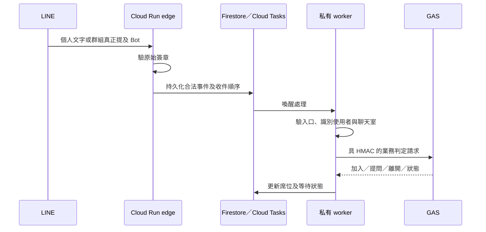
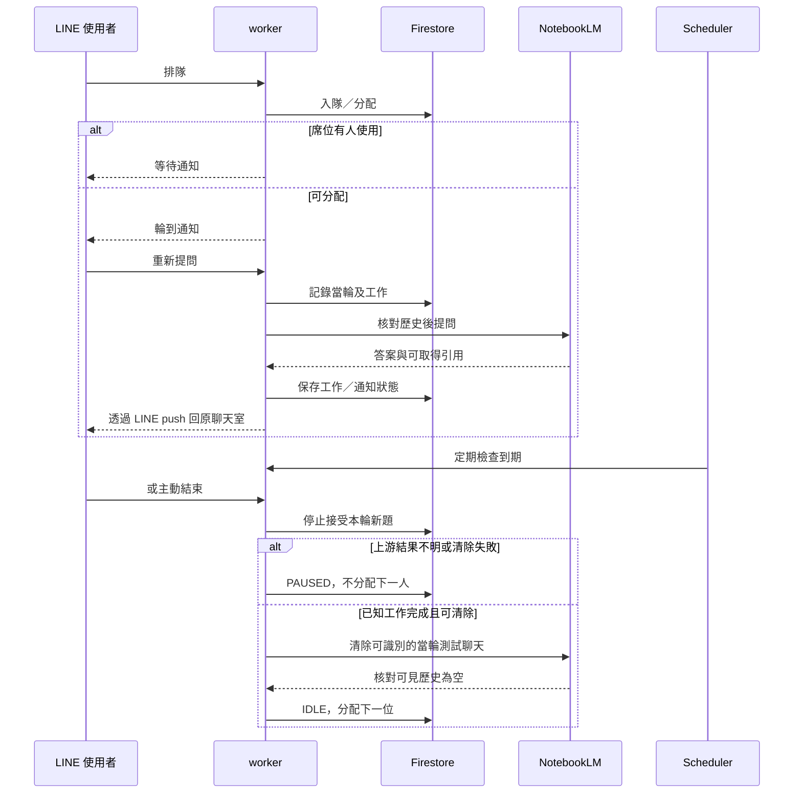

# 資訊流與時序

快照：2026-11-18。圖中為元件角色，不含運行網址或帳號資料。

## 收件與動作判定

此為主要路徑摘要，不表示整條流程是一個分散式交易；失敗、重試與去重各有證據界線。未通過入口條件的事件不應成為 NotebookLM 提問。

## 席位內提問、回覆及交接

圖中的到期與主動結束是替代觸發，不要求兩者都發生。未使用的邀請在歷史本來為空時可直接釋放。等待時的原問題沒有保存供日後自動重問。

## 身分與回覆目的地

| 情境 | 席位識別 | 回覆位置 |
|---|---|---|
| 個人 | 頻道＋使用者 | 原個人聊天室 |
| 群組 | 頻道＋群組＋使用者 | 原群組；內容公開 |
| 同人跨入口 | 視為不同情境 | 各自原入口，不把個人答案搬到群組 |

資料流成功只能證明觀察到的通路；引用支持、內容品質及多人隔離需另行驗證。
