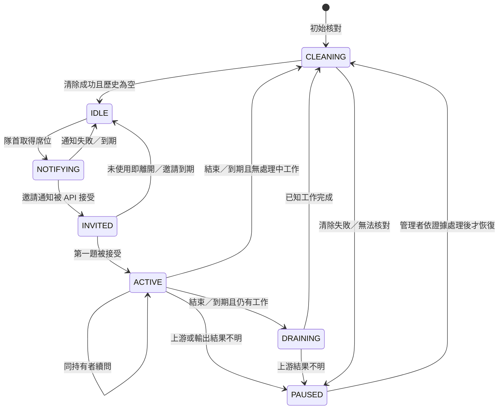

# 全域單席位狀態機

此為核心狀態的文件化摘要；實作狀態名採 `CLEANING`，不是 `CLEARING`。等待隊伍另行保存，不是一人一個 NotebookLM 對話。快照：2026-11-18。

PAUSED 的恢復箭頭描述原型的證據要求，不代表已交付完整正式人工恢復後台。所有會產生或核對未知狀態的入口亦可導致暫停，圖不枚舉每條錯誤路徑。

| 狀態 | 意義 | 是否接新問題 |
|---|---|---|
| IDLE | 乾淨、無持有者，可分配 | 先分配／邀請 |
| NOTIFYING | 已預留席位，邀請通知處理中 | 否 |
| INVITED | 已通知，等待第一題 | 僅持有者的第一題 |
| ACTIVE | 當輪進行中 | 僅持有者；單題處理中拒絕平行新題 |
| DRAINING | 已結束本輪，等處理中工作收尾 | 否 |
| CLEANING | 清除可識別聊天並核對 | 否 |
| PAUSED | 狀態不明或需要管理者處理 | 否 |

## 必須維持的條件

1. 同時最多一個持有者，持有者不重複出現在等待隊伍。
2. 工作及通知綁定當輪代數與原持有者，舊結果不能指派給新持有者。
3. 使用期間從第一題接受起算；閒置從最後接受問題起算。
4. 有處理中工作時不因 timeout 直接清除並換人。
5. 清除失敗或歷史不明時不繼續交接；可見歷史為空也不當作無限樣本的隔離保證。

Koopman 測試包含有限的標記對照；照護語料本輪只有歷史為空核對，換人標記測試尚待補。
